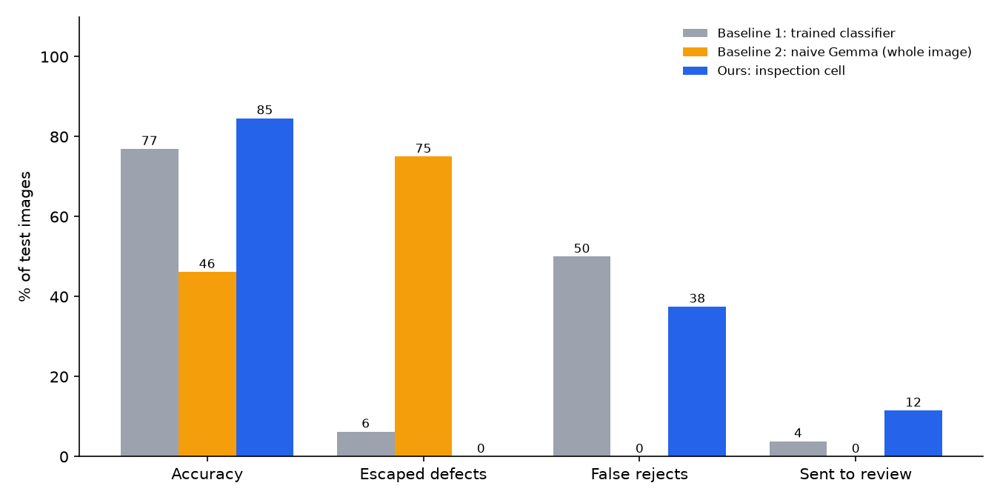

# Trusted Inspection Cell

An offline part-inspection cell where a **behaviour tree** runs the line and a local
**vision-language model (Gemma 3 4B via Ollama)** answers narrow questions about close-ups
the tree chooses. The AI never moves anything: each answer must pass a deterministic
validator, fixed rules turn the answers into a decision, and every failure mode falls back
to a human.

Entry for the Kaggle hackathon *Build with AI: Smart Automation, Robotics, and Vision*
(GDG Windsor). [Kaggle notebook](https://www.kaggle.com/code/naufalhakimi04/trusted-inspection-cell-gemma-3-behaviour-tree) ·
[dataset](https://www.kaggle.com/datasets/naufalhakimi04/trusted-inspection-cell-public)

## Results on real photos (26 unseen test photos of a cardboard board with 4 screws)

| Method | Accuracy | Defects shipped ↓ | Good boards rejected ↓ | Sent to a human | Time / board (laptop CPU) |
|---|---|---|---|---|---|
| Baseline 1: trained classifier (64x64 pixels, logistic regression) | 77% | 1 / 16 | 4 / 8 | 1 / 26 | < 0.1 s |
| Baseline 2: naive Gemma (whole image, trust its confidence) | 46% | **12 / 16** | 0 / 8 | 0 / 26 | 18 s |
| **Ours: inspection cell** | **85%** | **0 / 16** | 3 / 8 | 3 / 26 | 73 s |

Naive Gemma passed all 8 missing screws and all 4 scratches, each at "0.95 confidence". Our cell
found every empty hole at the correct corner by measurement alone (0.1 s), and Gemma's surface flags
landed on the drawn crack or scratch 6 times out of 7; the 3 rejected good boards were flagged at a
real fold crease in the cardboard. Details: [results/real/analysis.md](results/real/analysis.md);
synthetic experiment: [results/synthetic/analysis.md](results/synthetic/analysis.md) (95%, 0/30 shipped).



## How control flows

```
Inspection cycle                      (Sequence)
├── E-stop clear?                     deterministic: halts the line
├── Acquire part                      camera or folder
├── Classify                          (Selector)
│   ├── AI path                       (Sequence)
│   │   ├── Image quality OK?         deterministic: dark/blurry -> human, AI never sees it
│   │   ├── Screw presence check      deterministic: calibrated on training set; empty hole -> REJECT
│   │   ├── Model healthy?            circuit breaker: stop waiting on a failing model
│   │   ├── Inspect regions with VLM  Gemma, local, one close-up per spec region  <- the only AI step
│   │   └── Apply decision rules      deterministic
│   └── Route to human review         fallback for every failure above
├── E-stop clear? (pre-actuation)     re-checked after the slow AI step
└── Actuate diverter                  pass conveyor / reject bin / review shelf
```

**Who decides what**

| Deterministic (rules) | AI (Gemma) |
|---|---|
| Where to look: the part spec lists 4 screw positions and 5 surface areas ([cell/spec.py](cell/spec.py)) | Is there a screw in this close-up? Is this surface clean? |
| Whether the answer is usable: must describe what it saw, then give one allowed word | Describing what it sees, in words the operator reads |
| The decision: one defect -> REJECT; every region checked and OK -> PASS | |
| E-stop, image quality, timeouts, circuit breaker, actuation | |

## What we learned about the model (and why the design looks like this)

| Approach | Result with Gemma 3 4B on CPU |
|---|---|
| Whole part, "is it defective?" with confidence | Said a part with a **missing screw** was fine at **95% confidence**; missed the crack |
| Whole part, check each corner | Said all 4 screws present on every image |
| Close-up per corner, forced JSON answer | Same answer for every crop, right or wrong |
| Close-up per region, describe first, then answer | 16/16 screw positions on the first samples, but on the varied test set it called rotated ("X") screws empty and rejected every good part |
| Reworded screw prompt (tuned on training crops) | Screws right, but caught only 2/6 empty holes |
| **Final: deterministic presence check + Gemma second opinion + Gemma for surfaces** | **95% accuracy, 0/30 defects escaped** (see [results/synthetic/analysis.md](results/synthetic/analysis.md)) |

So: self-reported confidence is not used anywhere, the deterministic side decides where to
look and whether a screw is there, the model must describe before it answers, and a screw
is only OK when both the presence check and the model agree.

Cost: ~15-20 s per close-up on a laptop CPU, up to 9 per part (a defect stops the check
early). A GPU or edge accelerator brings this to seconds.

## What can go wrong

| Failure | What the cell does |
|---|---|
| Image too dark, bright or blurry | Human review, AI not called |
| Model timeout or server down | Human review; after 3 in a row, degraded mode (AI skipped, probed every 5 parts) |
| Answer with no description, no ANSWER line, or a word not allowed for that region | Answer rejected, human review |
| Operator hits e-stop mid-inspection | Decision is logged, diverter never moves |
| Operator disagrees | `review.py decide` override, logged with their name; the AI's decision is kept |

All thresholds live in [cell/config.py](cell/config.py).

## Run it

Setup (one time): install [Ollama](https://ollama.com), `ollama pull gemma3:4b`, then
`pip install -r requirements.txt` (Python 3.12+). Everything runs offline after that.

```bash
.venv/bin/python live.py                         # webcam station: place a board, press SPACE
.venv/bin/python live.py --mock                  # same, stand-in model: check camera and framing
.venv/bin/python run.py --source data/real/test --part cardboard_board --presence models/presence_cardboard.json
.venv/bin/python make_samples.py                 # synthetic test parts
.venv/bin/python run.py --source samples --mock  # dry run, no model needed
.venv/bin/python run.py --source samples         # real run with local Gemma
.venv/bin/streamlit run dashboard.py             # operator dashboard: live view, review queue, overrides, e-stop
.venv/bin/python review.py                       # same review queue, from the terminal
.venv/bin/python -m pytest                       # safety behaviour tests
```

## Experiment (baselines vs ours)

```bash
.venv/bin/python experiment.py --name synthetic --train data/synthetic/train --test data/synthetic/test
.venv/bin/python experiment.py --name real --train data/real/train --test data/real/test --part cardboard_board
```

| Method | What it is |
|---|---|
| Baseline 1: trained classifier | Logistic regression on 64x64 greyscale pixels, trained on the training set |
| Baseline 2: naive Gemma | Whole image, one question, trusts the model's confidence (our first design) |
| Ours: inspection cell | The full behaviour tree, unchanged |

Labels come from file names (`good_*`, `missing_screw_*`, `crack_*`, `scratch_*`, `dark_*`, `blurry_*`).
Synthetic data: 120 training / 100 test images, different random seeds, varied position,
lighting, background, screw rotation and defect placement ([experiments/dataset.py](experiments/dataset.py)).
The training set trains baseline 1 and is what the cell's prompts and regions were tuned on;
the test set is never used for tuning. Gemma methods run on 10 test images per label (CPU time).
Output: `results/<name>/report.md` and `comparison.png`.

E-stop: `touch runtime/ESTOP` (delete it to clear). Audit trail: `runtime/audit.jsonl`.

## Live webcam station

[live.py](live.py) shows the camera with the part spec drawn on it. A setup bar re-runs the
deterministic checks every second (sharpness, each screw's state, and framing advice such as
"camera LOWER" against the layout of the training photos), so an operator can set up a new camera
without the AI. SPACE inspects; results appear in the dashboard and the audit log.

A new camera or light changes what a screw looks like, so the screw check can be re-calibrated per
station: press **G** on good boards and **1-4** on boards missing the top-left / top-right /
bottom-left / bottom-right screw, then `live.py --calibrate`. It fits `models/presence_live.json` on
those photos only ([data/live_calib](data/live_calib)) and prints a leave-one-out check; the
test-set models are not changed. Gemma needs mains power on a laptop: on battery a crop can exceed
the 120 s timeout (the part then goes to a human).

Demo helpers for the video: [demo/demo.sh](demo/demo.sh) and [demo/VIDEO_SCRIPT.md](demo/VIDEO_SCRIPT.md).

Camera setup: region positions assume the part sits in the same place in every frame
(a jig or printed outline under a fixed camera).
