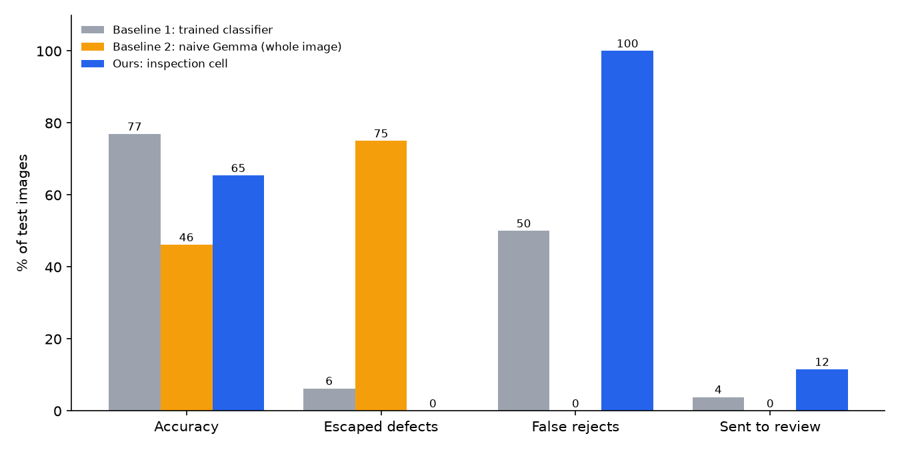

# Performance report: real

## Setup

- Training set: `data/real/train` (14 images)
- Test set: `data/real/test` (26 images); Gemma methods run on a stratified subset
- Model: gemma3:4b via Ollama, CPU only
- Images every method was tested on: 26

Expected decision: good -> PASS, any defect -> REJECT, unusable image -> REVIEW.
**Escaped defects** (defect decided PASS) is the number that matters most: those parts ship.
A REVIEW on a defective part is safe (a human sees it) but costs operator time.

## Results on the shared test images (n = 26)

| Method | Accuracy | Escaped defects ↓ | Defects auto-rejected | Good parts passed | Good parts falsely rejected ↓ | Sent to review | Time / part |
|---|---|---|---|---|---|---|---|
| Baseline 1: trained classifier | 77% (20/26) | 6% (1/16) | 94% (15/16) | 50% (4/8) | 50% (4/8) | 4% (1/26) | 0.0s |
| Baseline 2: naive Gemma (whole image) | 46% (12/26) | 75% (12/16) | 25% (4/16) | 100% (8/8) | 0% (0/8) | 0% (0/26) | 17.8s |
| Ours: inspection cell | 65% (17/26) | 0% (0/16) | 94% (15/16) | 0% (0/8) | 100% (8/8) | 12% (3/26) | 49.1s |

## Decisions by true label (shared test images)

**Baseline 1: trained classifier**

| True label | PASS | REJECT | REVIEW |
|---|---|---|---|
| blurry | 0 | 1 | 0 |
| crack | 0 | 4 | 0 |
| dark | 0 | 0 | 1 |
| good | 4 | 4 | 0 |
| missing_screw | 1 | 7 | 0 |
| scratch | 0 | 4 | 0 |

**Baseline 2: naive Gemma (whole image)**

| True label | PASS | REJECT | REVIEW |
|---|---|---|---|
| blurry | 1 | 0 | 0 |
| crack | 0 | 4 | 0 |
| dark | 1 | 0 | 0 |
| good | 8 | 0 | 0 |
| missing_screw | 8 | 0 | 0 |
| scratch | 4 | 0 | 0 |

**Ours: inspection cell**

| True label | PASS | REJECT | REVIEW |
|---|---|---|---|
| blurry | 0 | 0 | 1 |
| crack | 0 | 4 | 0 |
| dark | 0 | 0 | 1 |
| good | 0 | 8 | 0 |
| missing_screw | 0 | 8 | 0 |
| scratch | 0 | 3 | 1 |

