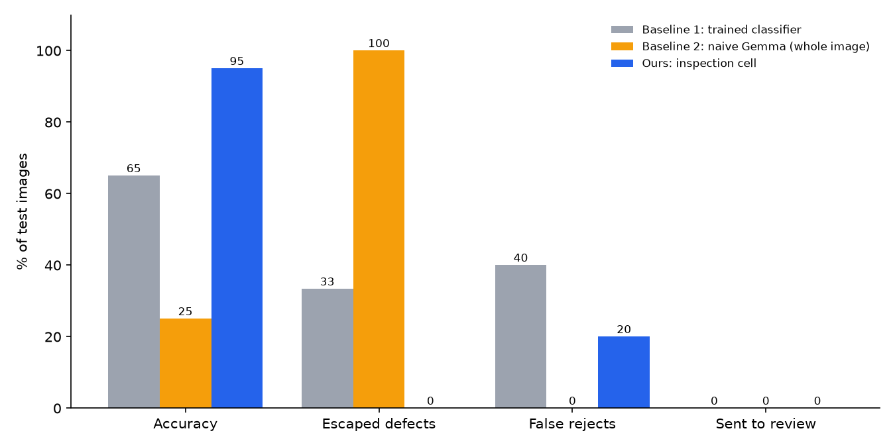

# Performance report: synthetic

## Setup

- Training set: `data/synthetic/train` (120 images)
- Test set: `data/synthetic/test` (100 images); Gemma methods run on a stratified subset
- Model: gemma3:4b via Ollama, CPU only
- Images every method was tested on: 40

Expected decision: good -> PASS, any defect -> REJECT, unusable image -> REVIEW.
**Escaped defects** (defect decided PASS) is the number that matters most: those parts ship.
A REVIEW on a defective part is safe (a human sees it) but costs operator time.

## Results on the shared test images (n = 40)

| Method | Accuracy | Escaped defects ↓ | Defects auto-rejected | Good parts passed | Good parts falsely rejected ↓ | Sent to review | Time / part |
|---|---|---|---|---|---|---|---|
| Baseline 1: trained classifier | 65% (26/40) | 33% (10/30) | 67% (20/30) | 60% (6/10) | 40% (4/10) | 0% (0/40) | 0.0s |
| Baseline 2: naive Gemma (whole image) | 25% (10/40) | 100% (30/30) | 0% (0/30) | 100% (10/10) | 0% (0/10) | 0% (0/40) | 17.8s |
| Ours: inspection cell | 95% (38/40) | 0% (0/30) | 100% (30/30) | 80% (8/10) | 20% (2/10) | 0% (0/40) | 86.9s |

Baseline 1: trained classifier on its full test set (n = 100): accuracy 65% (65/100), escaped defects 27% (20/75), good parts falsely rejected 60% (15/25).

## Decisions by true label (shared test images)

**Baseline 1: trained classifier**

| True label | PASS | REJECT | REVIEW |
|---|---|---|---|
| crack | 4 | 6 | 0 |
| good | 6 | 4 | 0 |
| missing_screw | 1 | 9 | 0 |
| scratch | 5 | 5 | 0 |

**Baseline 2: naive Gemma (whole image)**

| True label | PASS | REJECT | REVIEW |
|---|---|---|---|
| crack | 10 | 0 | 0 |
| good | 10 | 0 | 0 |
| missing_screw | 10 | 0 | 0 |
| scratch | 10 | 0 | 0 |

**Ours: inspection cell**

| True label | PASS | REJECT | REVIEW |
|---|---|---|---|
| crack | 0 | 10 | 0 |
| good | 8 | 2 | 0 |
| missing_screw | 0 | 10 | 0 |
| scratch | 0 | 10 | 0 |

